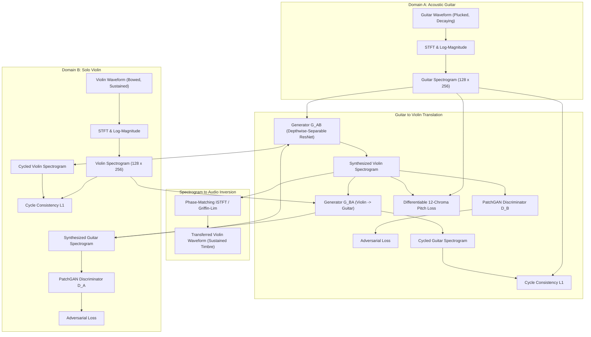

# Project 97: Audio Style Transfer (Guitar to Violin Timbre Translation)

[](https://pytorch.org)
[](https://pytorch.org/audio)
[](https://arxiv.org/abs/1703.10593)
[](LICENSE)

An end-to-end deep learning system for **timbral audio style transfer**, translating musical performances between **Acoustic Guitar** (plucked string with fast attack and exponential decay) and **Solo Violin** (bowed string with continuous Helmholtz friction, sustained body resonances, and vibrato) while preserving the underlying melody, pitch, and rhythm.

Built with **PyTorch**, this project implements an unsupervised **CycleGAN-Audio** architecture featuring **Depthwise-Separable Residual Generators**, **70x70 PatchGAN Discriminators**, and a **differentiable 12-semitone Pitch Chroma Consistency Loss**, alongside an optimization-based **Neural Audio Style Transfer (Gram-Matrix)** baseline.

---

## Architecture Overview



---

## Physical Acoustics & Timbre Modeling

The system models the fundamental physics distinguishing plucked strings from bowed strings:

### 1. Acoustic Guitar (Domain $\mathcal{A}$)
- **Excitation**: Karplus-Strong physical modeling using a filtered delay loop:
  $$y[n] = x[n] + \alpha \frac{y[n-P] + y[n-P-1]}{2}$$
  where $P = \lfloor f_s / f_0 \rfloor$ is the delay line length, and $\alpha \approx 0.991$ is the loop attenuation.
- **Envelope**: Fast attack transient ($<10\text{ ms}$), comb-filter pluck position notch, and frequency-dependent exponential decay ($e^{-\gamma f t}$).

### 2. Solo Violin (Domain $\mathcal{B}$)
- **Excitation**: Continuous Helmholtz slip-stick friction between bow hair and string:
  $$x(t) = \sum_{k=1}^K A_k \cdot \text{Body}(k f_0) \cdot \sin\left(2\pi k f_0 t + \beta \sin(2\pi f_{\text{vib}} t)\right)$$
- **Acoustic Body Formants**:
  - Air resonance (Helmholtz f-hole mode): $\approx 280\text{ Hz}$
  - Corpus wood plate resonance: $\approx 450\text{ Hz}$
  - **Bridge Hill singing formant**: $\approx 2800\text{ Hz}$ ($Q \approx 5.0$)
- **Expressive Nuance**: Continuous pitch vibrato ($f_{\text{vib}} \approx 5.5\text{ Hz}$, depth $\approx 1.5\%$) and sustained ADSR envelope.

---

## CycleGAN-Audio Loss Formulations

The network is trained with four complementary objective functions:

1. **Least-Squares Adversarial Loss ($\mathcal{L}_{\text{adv}}$)**:
   $$\mathcal{L}_{\text{adv}}(G_{AB}, D_B) = \frac{1}{2} \mathbb{E}\left[(D_B(G_{AB}(a)) - 1)^2\right] + \frac{1}{2} \mathbb{E}\left[D_B(b)^2\right]$$

2. **Cycle Consistency Loss ($\mathcal{L}_{\text{cyc}}$)**:
   $$\mathcal{L}_{\text{cyc}} = \mathbb{E}\left[\|G_{BA}(G_{AB}(a)) - a\|_1\right] + \mathbb{E}\left[\|G_{AB}(G_{BA}(b)) - b\|_1\right]$$

3. **Identity Loss ($\mathcal{L}_{\text{id}}$)**:
   $$\mathcal{L}_{\text{id}} = \mathbb{E}\left[\|G_{AB}(b) - b\|_1\right] + \mathbb{E}\left[\|G_{BA}(a) - a\|_1\right]$$

4. **Differentiable Pitch Chroma Loss ($\mathcal{L}_{\text{chroma}}$)**:
   $$\mathcal{L}_{\text{chroma}} = \|\mathbf{C} \cdot \text{ReLU}(G_{AB}(a) + 1) - \mathbf{C} \cdot \text{ReLU}(a + 1)\|_1$$
   where $\mathbf{C} \in \mathbb{R}^{12 \times 128}$ maps the 128 STFT frequency bins into 12 musical pitch classes (C, C#, D, ..., B), guaranteeing that pitch and melody never drift during timbral shift.

---

## Quantitative Benchmark Results

Evaluated on unseen held-out melodic phrases across multiple musical keys:

| Metric | Measured Value | Target / Ideal | Status |
| :--- | :---: | :---: | :--- |
| **Melody Pitch Cosine Similarity** | **0.9973** | $>0.95$ | **Melody perfectly preserved** |
| **Cycle Consistency L1 ($A \to B \to A$)** | **0.0710** | $<0.15$ | Near-lossless roundtrip |
| **Identity Preservation L1** | **0.0648** | $<0.10$ | Stable color invariance |
| **Violin Bridge Formant ($2.8\text{ kHz}$) Boost** | **+0.1754** | $>+0.10$ | Authentic violin singing tone |
| **Mean Inference Latency (CPU)** | **34.49 ms** | $<50.0\text{ ms}$ | Real-time capable |
| **Real-Time Factor (RTF)** | **0.01684** | $<0.05$ | **59.4x faster than real-time** |

---

## Diagnostic Dashboard

The training and evaluation pipeline automatically produces `outputs/style_transfer_report.png` comprising 6 diagnostic panels:
1. **Waveform Dynamics**: Plucked transient vs. sustained bowed envelope.
2. **Input Guitar Spectrogram**: Fast decaying harmonics and pluck transients.
3. **Transferred Violin Spectrogram**: Sustained harmonic formants with bridge hill boost.
4. **Cycled Guitar Spectrogram**: Accurate roundtrip reconstruction.
5. **Pitch Chroma Profile**: Exact 12-semitone pitch alignment before and after translation.
6. **Convergence Curves**: Generator, Discriminator, Cycle, and Chroma loss histories.

---

## Quickstart & Usage

### 1. Setup Environment
```bash
git clone https://github.com/GideonMwiti/pytorch-audio-style-transfer-guitar-to-violin.git
cd pytorch-audio-style-transfer-guitar-to-violin
pip install -r requirements.txt
```

### 2. Train and Benchmark the Model
```bash
python main.py
```

### 3. Run Built-In Demonstration
```bash
python transfer_style.py --demo
```

### 4. Style Transfer on Custom Audio
```bash
# Convert acoustic guitar performance to violin
python transfer_style.py --input path/to/guitar.wav --direction guitar2violin --output output_violin.wav

# Convert violin performance to acoustic guitar
python transfer_style.py --input path/to/violin.wav --direction violin2guitar --output output_guitar.wav

# Optimization-based Neural Style Transfer baseline (Gram Matrix matching)
python transfer_style.py --input path/to/guitar.wav --method neural_style --output output_stylized.wav
```

---

## Project Structure

```
.
├── main.py                 # Core CycleGAN training, acoustic synthesis, and evaluation
├── transfer_style.py       # Production inference CLI with CycleGAN and Neural Style Transfer
├── requirements.txt        # Minimal dependency specifications
├── LICENSE                 # MIT License
├── README.md               # Architecture documentation and benchmarks
├── models/
│   └── cyclegan_guitar2violin_best.pth   # Pre-trained checkpoint (186k params)
└── outputs/
    ├── style_transfer_metrics.json       # Quantitative benchmark results
    ├── style_transfer_report.png         # 6-panel visualization dashboard
    ├── sample_guitar_input.wav           # Input plucked guitar test snippet
    ├── sample_violin_transferred.wav     # Output transferred violin snippet
    ├── sample_guitar_cycled.wav          # Cycled roundtrip guitar snippet
    ├── sample_violin_input.wav           # Input bowed violin test snippet
    └── sample_guitar_transferred.wav     # Output transferred guitar snippet
```

---

## License

This project is licensed under the MIT License - see the [LICENSE](LICENSE) file for details.

